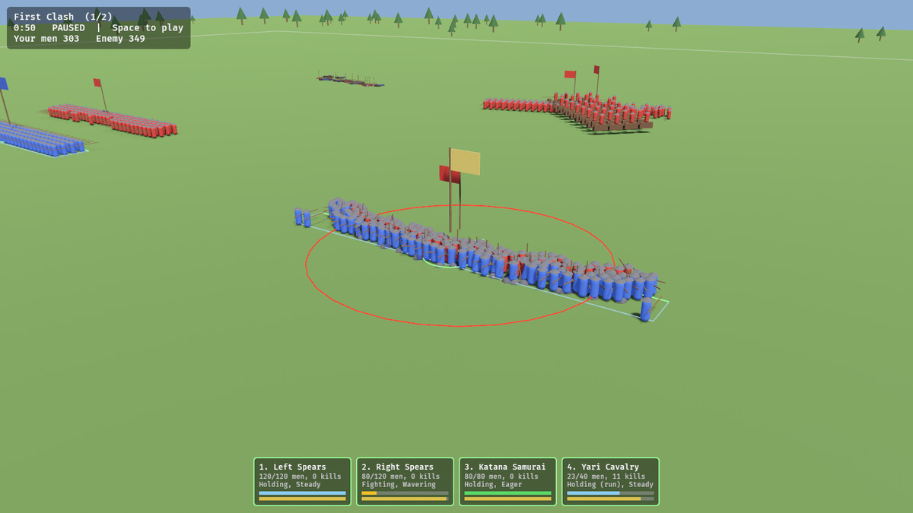

# Fylking

An open-source battle game in the spirit of Total War: blocks of soldiers in
formation, charges, flanking and morale that breaks. *Fylking* is Old Norse for
a battle array.



This is the first prototype: real-time battles on a flat field with spears,
samurai and cavalry. No campaign map yet.

## Running it

You need Rust (https://rustup.rs). Then, from this folder:

```sh
cargo run --release
```

The first build takes a while (Bevy is big); after that it's quick.

On Linux you may also need: `sudo apt install libasound2-dev libudev-dev pkg-config`.

The game starts **paused** so you can look around. Press **Space** to begin.

## Controls

| | |
|---|---|
| **Camera** | WASD / arrows pan · Q E rotate · Z X tilt · wheel zoom · middle-drag to look |
| **Select** | Left click · drag a box · Shift adds · Ctrl+A all · 1-9 by number · Esc clears · click a unit card |
| **Move** | Right click the ground |
| **Attack** | Right click an enemy |
| **Formation** | Right *drag* to draw the front line: sets the width and facing. With several units selected, the line is shared between them |
| **Run** | Double right-click, or R to toggle |
| **Halt** | H |
| **Battle** | Space pause · + / − speed · F5 restart · Tab next scenario · F1 help |

## How battles work

- **Formations.** Each unit has an anchor and facing; each man has a slot in
  the ranks and steers to it. When a unit turns or reshapes, men are re-slotted
  so they don't walk through each other.
- **Melee.** Once units close, each soldier picks the nearest enemy and fights
  on his own. Hit chance comes from attack vs. defence; damage from damage vs.
  armour. Blows from the side or behind are harder to parry.
- **Charges.** A soldier running into contact gets a charge bonus for a few
  seconds and shoves the man he hits. Heavy cavalry knocks infantry flat.
  **Spears bracing** (standing still, facing the charge) wreck a frontal
  cavalry charge.
- **Morale.** Falls with casualties, sudden losses, being charged, being hit in
  the flank or rear, nearby friends routing and exhaustion. At zero the unit
  routs. Routers flee, and may rally if left alone. Units that lose too many
  men, or rout three times, shatter for good.
- **Stamina.** Running and fighting tire men out; tired men fight and move worse.
- **AI.** Infantry advance on the nearest enemy. Cavalry wait for the lines to
  meet, then look for a unit that's busy fighting to hit in the flank, and
  avoid charging spears head-on.

## Modding

Everything you'd want to tweak is in `assets/data/`:

- `units.toml`: every unit type and its stats, documented at the top of the
  file. Add a new `[table]` to add a unit.
- `scenarios/*.toml`: battles. Pick units, teams, positions, facings and widths.
  Any `.toml` you drop in this folder shows up in the game (Tab cycles).

Press **F5** in game to reload the data files and restart, so you can tune
stats without rebuilding. Set `FYLKING_DATA=/path/to/data` to point the game
at a different data folder.

To balance without the game, run a battle headless with the AI on both sides:

```sh
cargo run --release -p fylking_sim --example headless -- spear_duel
```

## Code layout

```
crates/fylking_sim    the battle simulation: pure Rust, no engine, deterministic
  src/battle.rs       units, soldiers, formations, combat, charges, morale
  src/ai.rs           the battle AI
  src/data.rs         TOML formats for units and scenarios
  src/grid.rs         spatial grid for fast neighbour lookups
  tests/battle.rs     behaviour tests (cargo test -p fylking_sim)
crates/fylking_game   Bevy front end: 3D view, camera, controls, HUD
assets/data           units and scenarios
```

The sim knows nothing about graphics, and given the same seed and orders it
always plays out the same way. That keeps it testable, and leaves the door
open for replays and lockstep multiplayer later.

## Roadmap

See [ROADMAP.md](ROADMAP.md) for the full feature list and build order.

## Ideas for what's next

- Ranged units (archers, teppo) with ballistic arcs and ammo
- Terrain: hills (height advantage), forests, rivers
- Generals: aura that steadies morale, death that shakes it
- Formation options: loose/tight, wedge, spear wall
- Proper models and animation (the sim already exposes swing, hit, stun and
  death timers to drive them)
- Campaign map

## Licence

Dual-licensed under MIT or Apache-2.0, at your option, like Bevy and most of
the Rust ecosystem.
